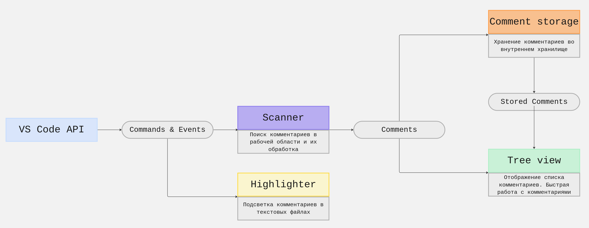
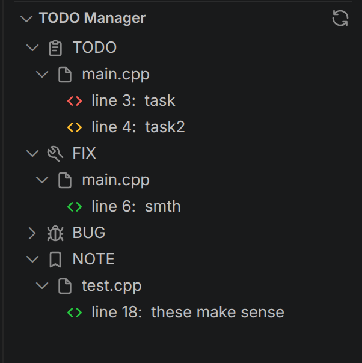
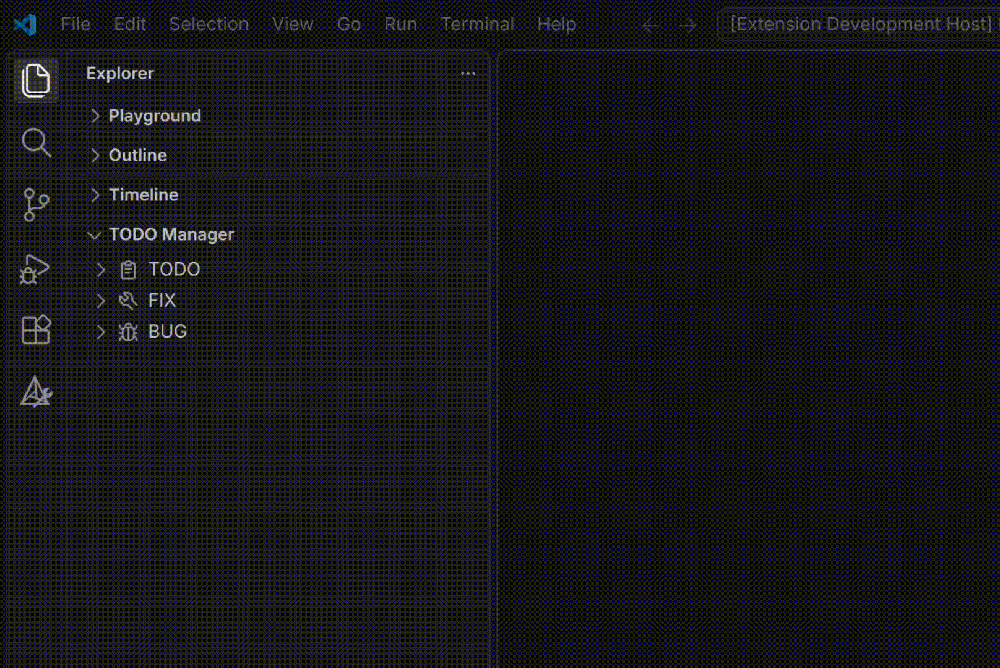
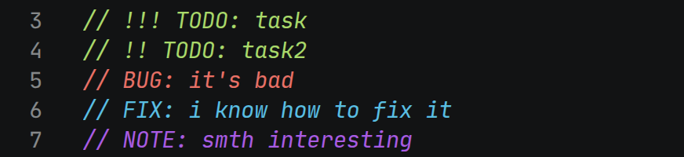

# Оглавление

- [Общая информация](#общая-информация)
  - [Автор проекта](#автор-проекта)
  - [Описание проекта](#описание-проекта)
- [Функционал плагина](#функционал-плагина)
  - [Упрощенная схема устройства плагина](#упрощенная-схема-устройства-плагина)
  - [Поиск и анализ комментариев](#поиск-и-анализ-комментариев)
  - [Типы и приоритеты комментариев](#типы-и-приоритеты-комментариев)
  - [Взаимодействие с комментариями](#взаимодействие-с-комментариями)
    - [UI-представление](#ui-представление)
    - [Функционал UI](#функционал-ui)
    - [Визуализация](#визуализация)
    - [Пример процесса взаимодействия](#пример-процесса-взаимодействия)
  - [Подсветка комментариев](#подсветка-комментариев)
  - [Настройки плагина](#настройки-плагина)
- [Документация кода плагина](#документация-кода-плагина)

# Общая информация

## Автор проекта

**ФИО:** Юркин Тимофей Артёмович

**Номер ИСУ:** 558649

**Группа:** М3105

## Описание проекта

**TODO Manager** – это плагин для VS Code, упрощающий и ускоряющий работу с комментариями в рабочем пространстве IDE.

Плагин предоставляет пользователю следующий функционал:

1. Подсветка комментариев в коде проекта.
   
2. Поддержка специального синтаксиса для разделения комментариев по их типам и категориям.

3. UI-элемент для боковой панели IDE, позволяющий быстро управлять комментариями из одного места.
  
Подробнее с возможностями плагина можно ознакомиться в секциях документации, располагающихся ниже.

# Функционал плагина

## Упрощенная схема устройства плагина



## Поиск и анализ комментариев

При запуске VS Code плагин автоматически начинает свою работу. Используя VS Code API, плагин способен построчно анализировать каждый текстовый документ в вашем проекте, чтобы найти в них комментарии и собрать информацию о них.

> [!NOTE]
> Плагин не будет собирать информацию о ВСЕХ комментариях. Область 
> ответственности плагина - комментарии определенных типов. Подробнее о типах
> можно прочитать [здесь](#типы-и-приоритеты-комментариев).

Анализ файлов не происходит постоянно: это процесс, который можно запустить двумя способами:

1. Команда `TODO Manager: scan workspace` в палитре команд VS Code.

2. Кнопка обновления в UI-представлении [структуры комментариев](#взаимодействие-с-комментариями).

Периодически эти команды необходимо выполнять, чтобы структура комментариев плагина синхронизировалась с реальным состоянием проекта. 

## Типы и приоритеты комментариев

Чтобы пользователь сам мог определять, какие комментарии должны попасть в итоговое представление UI-элемента структуры комментариев и как эти комментарии должны быть распределены по этому элементу, существует система типов. Всего существует 4 типа комментариев:

| Тип     | Значение наименования                   |
| ------- | --------------------------------------- |
| TODO    | Задача, которую необходимо выполнить    |
| BUG     | Баг в коде, причина которого неизвестна |
| FIX     | Решение для найденного бага             |
| NOTE    | Какая-то общая заметка о коде           |

Опираясь на эти типы, плагин будет искать в тексте ваших файлов комментарии.
Чтобы комментарий был обработан при анализе проекта плагином, он должен иметь следующую структуру:

```
# (или любой другой символ начала комментария) TYPE: comment text
```

Поэтому данный комментарий будет обработан плагином:

```
# TODO: implement function add(a, b)
```

А эти комментарии - нет:

```
# WRONG-type: comment
# I don't have any type!
# wrong direction :TODO
```

Также вы можете устанавливать уровень приоритетности комментария. Для этого
перед его типом необходимо поставить `!`, `!!` или `!!!` (низший приоритет -> высший приоритет):

```
// !!! TODO: I'm super important
// !! FIX: Still important, but not that much
// ! NOTE: you can forget about me
```

Если приоритет не выставлен пользователем вручную, то он считается низшим. Если выставлен приоритет из более 3 символов, то считается, что у комментария высший приоритет, как и при `!!!`.

Приоритет влияет на цвет [UI-элемента](#взаимодействие-с-комментариями) комментария, что позволяет быстро понимать, какая задача на данный момент более важна.

## Взаимодействие с комментариями

### UI-представление

Полученная после анализа проекта информация используется для построения древовидного UI-представления структуры комментариев в проекте, в боковой панели рабочего пространства, с помощью которой вы можете быстро манипулировать комментариями:



> [!WARNING]
> Обновление данной структуры не происходит автоматически: если вы хотите, чтобы данные синхронизировались с текущим состоянием проекта, вам необходимо запустить команду для сканирования проекта.

### Функционал UI

Корневые элементы этой структуры - [типы комментариев](#типы-и-приоритеты-комментариев). В каждый корневой элемент вложены элементы файлов, в которых хранятся комментарии этого типа. А в каждый элемент файла вложены комментарии, которые в нем расположены.

При клике на элемент комментария плагин откроет файл с выбранным комментарием и сфокурисует курсор на начале строки с ним. Также у каждого элемента комментария есть контекстное меню с тремя опциями:

1. `Open comment` - производит аналогичные действия, что и при клике.

2. `Remove comment` - мягкое удаление комментария из UI-структуры. Физически комментарий останется в текстовом файле. Данная команда нужна в случае, если доступ к комментарию по какой-то причине невозможен (например, был удален файл с этим комментарием).

3. `Delete comment` - жесткое удаление комментария и из UI-структуры, и из текстового файла, в котором он находится.

> [!IMPORTANT]
> Если после удаления элемента комментария оказывается, что элемент файла пуст, то удаляется и элемент файла. Если это приводит к тому, что корневой элемент также становится пустым, то корневой элемент тоже удаляется.

При нажатии на кнопку "Перезагрузка" происходит повторный анализ проекта для синхронизации с его текущим состоянием.

### Визуализация

Каждый элемент комментария помечен цветом: зеленым, желтым и красным. Цвет комментария соответствует его [уровню приоритетности](#типы-и-приоритеты-комментариев) в порядке возрастания.

Если вам не нравятся иконки для корневых элементов UI, вы можете отключить их в [настройках плагина](#настройки-плагина).

### Пример процесса взаимодействия



## Подсветка комментариев

В отличие от UI-представления, подсветка комментариев происходит в режиме реального времени. Каждый тип комментария имеет свою собственную подсветку:



Если вам не нравится подсветка комментариев, вы можете отключить её в [настройках плагина](#настройки-плагина).

## Настройки плагина

Для плагина существует два настраиваемых пункта:

1. `Highlight comments` - вкл / выкл [подсветки комментариев](#подсветка-комментариев) в коде.

2. `Show group icons` - вкл / выкл [иконки для корневых UI-элементов](#визуализация).

---
# [Документация кода плагина](./modules.md) 